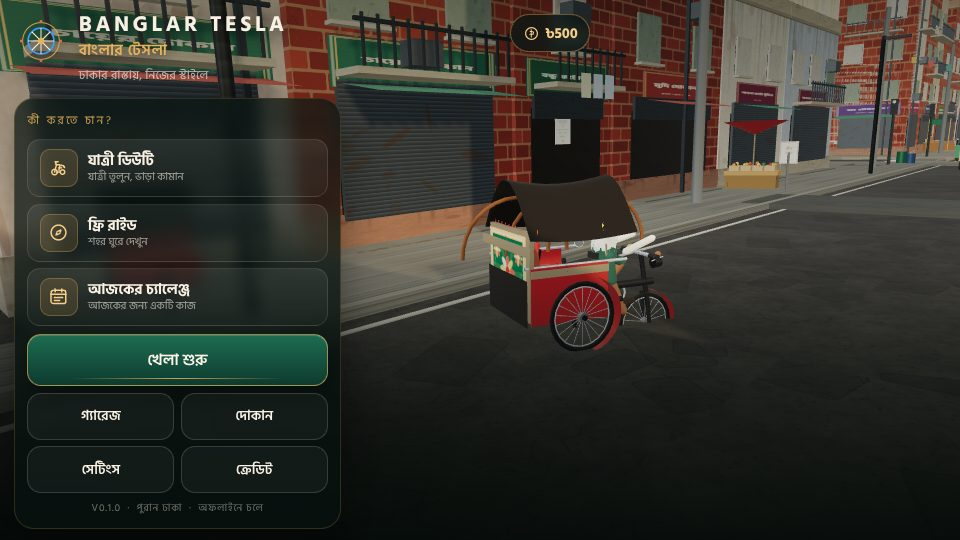

# BANGLAR TESLA — বাংলার টেসলা

**ঢাকার রাস্তায়, নিজের স্টাইলে** — a 3D cycle-rickshaw life simulator set in a fictionalised
Old Dhaka neighbourhood. Pick up passengers, weave through messy-but-readable traffic, keep
your rider happy, earn **৳** taka, repair and repaint the rickshaw, and come back to it all
after a cold restart.

This repository is the **Phase 1 vertical slice**: one compact, hand-authored neighbourhood,
one fully drivable pedal rickshaw, traffic with left-hand-drive lanes and signals, pedestrians,
a complete passenger job loop with fare maths, an economy with an upgrade/repaint garage,
a store, settings that really change the game, versioned save/load, and original synthesised
Bangla-flavoured audio. It runs offline on a phone, installed from the browser.



---

## 1. Status: what this build actually is

| Area | State |
|---|---|
| Playable end-to-end loop (job → drive → deliver → taka → store → save) | **Done and verified in an automated browser run** |
| Drivable rickshaw physics, camera, touch + keyboard controls | **Done** |
| Old-Dhaka-style neighbourhood, signage, props, ambience | **Done (Phase 1 scope)** |
| Traffic (bus/car/CNG/motorcycle/rickshaw/truck) + junction signals | **Done (route-based, 5–16 vehicles by quality)** |
| Pedestrians (instanced, sidewalk paths, avoidance) | **Done** |
| Passenger actor, pickup/board/drop-off, dialogue, mood | **Done** |
| Fare maths, economy, garage upgrades, cosmetics, repairs | **Done** |
| Store, credits, settings (graphics/audio/controls/a11y/language) | **Done** |
| Versioned save with corrupt-file recovery + `.bak` | **Done** |
| Original synthesised music (3 loops) and SFX | **Done** |
| Bangla + English localisation with Hind Siliguri | **Done** |
| Offline installable PWA + fullscreen + landscape | **Done** |
| Native Android APK | **Not built — see §7 and `docs/ANDROID_PACKAGING.md`** |
| Photo mode, replays, extra districts, weather radar events | **Backlog (`docs/CONTENT_ROADMAP.md`)** |

### Honest note about the engine

The master brief recommends **Godot 4.x + GDScript** for an Android APK. I checked this
sandbox first:

* no Godot binary is installed, and the Godot release downloads
  (`release-assets.githubusercontent.com`) are **not reachable** from this environment;
* there is **no Android SDK, no JDK and no export templates**, so an APK physically cannot be
  produced here even with the editor.

Rather than deliver an unverifiable Godot project I cannot run, I built the slice on the
**web/three.js** stack — which the skill router explicitly supports (`threejs-scene-setup`,
`threejs-materials-lighting`, `threejs-gltf-loading`) and which I *can* run, screenshot and
test in this environment with a real (software-rendered) Chromium. Everything is TypeScript +
three.js with no backend, and it installs to an Android home screen as a fullscreen
offline-capable PWA. `docs/ANDROID_PACKAGING.md` documents the exact path to a signed APK/AAB
and what a Godot port would need.

---

## 2. Quick start (development)

```bash
npm install
npm run dev        # http://localhost:5173  (binds 0.0.0.0)
npm run build      # typecheck + production build into dist/
npm run preview    # serve the production build on :4173
npm test           # 61 unit tests (vitest)
npm run test:e2e   # 21 automated gameplay checks (puppeteer + bundled Chromium)
npm run test:ui    # 17 click-through checks using only real DOM buttons
npm run shots -- menu,duty,garage,night,rain   # screenshots into artifacts/
```

The tests are real: `npm run test:e2e` launches a headless Chromium with SwiftShader WebGL,
boots the game, plays a full passenger job (accept → board → drive → deliver → payout), buys a
cosmetic, flips graphics quality and language, reloads the page and asserts the save survived.
See `docs/TEST_REPORT.md` for the captured output of the last run.

---

## 3. Controls

### Touch (primary)

| Control | Action |
|---|---|
| `◀` / `▶` (left cluster) | steering |
| Big round **প্যাডেল / PEDAL** (right) | hold to pedal |
| Round **ব্রেক / BRAKE** | brake; **hold while stopped** to reverse |
| 🔔 bell button | rickshaw bell |
| `❚❚` (top-right) | pause |
| 🎥 (top-right) | toggle chase / close camera |

Settings → Controls offers an **analog steering wheel** instead of buttons, **left-handed
layout** (swaps the clusters), sensitivity and dead-zone sliders, and camera-shake / haptics
toggles. Multi-touch is required (pedal + steer at the same time) and works.

### Keyboard (development / desktop)

| Key | Action |
|---|---|
| `W` / `↑` | pedal |
| `S` / `↓` | brake, hold at standstill to reverse |
| `A` `D` / `←` `→` | steer |
| `Space` | bell |
| `C` | camera mode |
| `R` | recover rickshaw |
| `Esc` / `P` | pause |

---

## 4. What is in the build

### The neighbourhood (`src/world/`)

A hand-authored block layout (not random): a main road, a cross road, two perimeter lanes,
two shopping “gali” dead-ends, junctions with zebra crossings, speed humps, patched asphalt,
drains and kerbs. Building facades are generated from a modular kit (plinth, parapet, shutters,
balconies with laundry, AC units, pipes, posters, roof water tanks) using a merged-geometry
pipeline so the whole street is a handful of draw calls. Shop boards are drawn into a single
2048² canvas atlas with **real Bangla text** (`চায়ের দোকান`, `মুদি দোকান`, `রিকশা মেরামত`,
`ফার্মেসি`, `বই ঘর`, `ভাড়া হবে`, `ধীরে চলুন`, …). Street props: tea stall with kettle and
bunting, fruit cart, crate stacks, tyre piles, construction barriers, benches, bins, a parked
rickshaw stand, power poles with sagging catenary wires, and a riverfront-inspired northern
edge with water, steps and moored boats.

### The rickshaw (`src/vehicle/rickshawModel.ts`)

A hand-built three-wheeler: one front wheel, two rear wheels with spoked rims, mudguards,
handlebar with brake levers and bell, front lamp, saddle, framed passenger bench with upholstery,
ornate rear panel with **procedurally painted rickshaw art** (floral / bird / river / cinema
motifs), canopy with wooden bows, nine swinging tassels, mirrors, plastic flowers and a ঢাকা
number plate. The rig animates: wheel spin from real speed, steering angle, a two-bone
pedalling rider, canopy sway and tassel physics driven by lateral acceleration.

### Driving (`src/vehicle/rickshawController.ts`)

A pure, unit-tested model: progressive acceleration with falloff, coasting drag, brake-to-stop,
reverse only after a deliberate hold, speed-dependent steering (tight low-speed turning circle,
stable at speed), bicycle-model yaw, circle-vs-AABB collision resolution against the city,
speed-hump pitch/roll response, stuck detection, and per-surface grip (road / footpath / offroad).
No random rollovers; no instant velocity changes.

### Traffic & pedestrians (`src/ai/`)

Closed waypoint loops with **left-hand lane offsets** (Bangladesh drives on the left), rounded
corner interpolation, car-following with braking distance, player blocking, junction signal
cycles (green → amber → red with visible lamp heads), distance culling and quality-driven
vehicle counts. Pedestrians are instanced (4 draw calls for the whole crowd), walk sidewalk
paths at varied speeds, pause, and step aside when the rickshaw approaches.

### Missions, economy, save (`src/missions/`, `src/economy/`, `src/core/`)

Seeded mission generator (pickup/drop-off pair, road distance, target time, optional request,
fare estimate), three mission flavours (Passenger Duty, Free Ride, offline Challenge of the
Day), transparent fare breakdown shown on the result screen (base + distance + on-time +
smoothness + tip − damage), mood that reacts to collisions, hard braking and time pressure.
Economy: ৳500 starter balance, catalogue-driven prices, unpurchasable-if-locked vehicles,
single-charge purchases, `balance >= 0` guaranteed by a pure guard, repair quotes.
Save: schema **version 2** with migration, sanitisation of hostile/corrupt data, atomic-ish
write with a `.bak` backup, automatic recovery from a corrupt main file (the corrupt payload is
kept for debugging), throttled autosave and explicit saves at safe points.

### Audio (`src/audio/audio.ts`)

All sound is **synthesised at runtime** — no samples, no licensing risk. Six buses
(music / ambience / traffic / vehicle / dialogue / ui) under a limiter. Three original loops:
*Cassette Dhaka* (menu/garage), *Rickshaw Radio* (daytime driving), *Brishti at Dusk* (rain/scenic).
SFX: metallic bell (three variants), pedal/drivetrain hum tied to speed, tyre rumble, impact
thud, brake squeal, coin, UI taps, success/fail stingers, distant horns with panning, crows and
tea-cup clinks. Rain and crowd beds follow weather/quality.

### UI (`src/ui/`)

DOM-based UI (so Bangla renders with the real font shaper, not a texture atlas), styled with a
cream/green/red/gold design system, safe-area aware, anchored and container-driven. Screens:
boot sting → main menu (hero rickshaw, live street behind, mode cards) → HUD (objective, fare,
distance, timer, mood, minimap, touch controls, contextual hints) → pause → job offer → result →
garage/showroom → store → settings → credits → tutorial. Keyboard focus is supported on desktop.

---

## 5. Project layout

```
index.html                  boot splash, fonts preload, canvas
src/
  main.ts                   entry: boots Game, splash, PWA registration
  game.ts                   orchestration, frame loop, mode/lifecycle, test hooks
  styles.css                the whole UI design system
  core/      config, mathx, i18n (bn/en), events, settings, save, gameState, input
  world/     layout data, textures (all procedural), geo/batching, city, props,
             environment (sky/sun/fog/rain/lamps), showroom
  vehicle/   rickshawModel (art + rig), rickshawController (physics), chaseCamera
  ai/        routes, vehicles (models), traffic, pedestrians
  missions/  actors (passenger rig), mission (generator), missionSystem (runtime)
  economy/   catalog (vehicles/upgrades/cosmetics/tapes), economy (fares/stats)
  audio/     audio.ts (synth engine, buses, music sequencer)
  ui/        dom helpers, icons, ui.ts (all screens)
  tests/ (repo root) unit/ (vitest) and e2e/ (puppeteer)
public/      fonts (Hind Siliguri, OFL), icons, manifest, service worker
docs/        test report, known issues, roadmap, Android packaging, screenshots
```

---

## 6. Quality, performance and accessibility

* **Quality presets** (Low/Battery saver, Balanced, High) change render scale, pixel ratio cap,
  shadow map size and distance, traffic count (6/10/16), pedestrian count (8/16/26), rain
  particle budget, lamp count, fog density and environment reflections — immediately.
* **Dynamic fallback**: if the measured frame rate stays below ~24 FPS for a sustained period,
  the game drops itself to Low once and tells the player.
* **Merged geometry + instancing**: city shells are merged per material; pedestrians, poles and
  wheels use instancing; only one shadow-casting directional light.
* **Accessibility**: text size, HUD scale, reduce-effects (dampens shake and flashing),
  camera-shake toggle, subtitle toggle, haptics toggle, 30/60 FPS target, left-handed layout,
  analog/dead-zone/sensitivity controls, high-contrast objective markers.
* **Localisation**: every player-facing string is a key in `src/core/i18n.ts`; Bangla is the
  default. A unit test asserts both languages are complete, that placeholder sets match, and
  that no Bangla string is corrupted.

---

## 7. Android

The game is a **PWA**: open it in Chrome on Android, use “Add to Home screen”; it launches
fullscreen, in landscape, and works offline after the first load (service worker in
`public/sw.js`). `manifest.webmanifest` declares the name in Bangla and English, maskable icons,
theme colour and `display: fullscreen`.

A native wrapper (APK/AAB) is **not produced in this sandbox** — no Android SDK/JDK and no
Godot. `docs/ANDROID_PACKAGING.md` gives the two viable routes (Capacitor/TWA wrapper, or a
Godot port), with exact commands, and lists what must change in this codebase for each.

---

## 8. Credits & licensing

* Engine/library: **three.js r186** (MIT), **Vite** (MIT), **TypeScript** (Apache-2.0).
* Font: **Hind Siliguri** by Indian Type Foundry — **SIL Open Font License 1.1**
  (`public/fonts/OFL.txt`).
* Models, textures, signage, UI and icons: **original, generated procedurally in this codebase**.
* Music and SFX: **original, synthesised at runtime** — no recordings, no sampled or
  re-created copyrighted songs.
* The map is a **fictional game layout inspired by Old Dhaka**, not a navigation map.

Full details in [`ASSET_CREDITS.md`](ASSET_CREDITS.md).

## 9. Known limitations

See [`docs/KNOWN_ISSUES.md`](docs/KNOWN_ISSUES.md). Headlines: no native APK yet; the
neighbourhood is one district; traffic is route-following rather than fully free-roaming;
no rain-vs-braking split beyond a grip multiplier; photo mode is not implemented.
